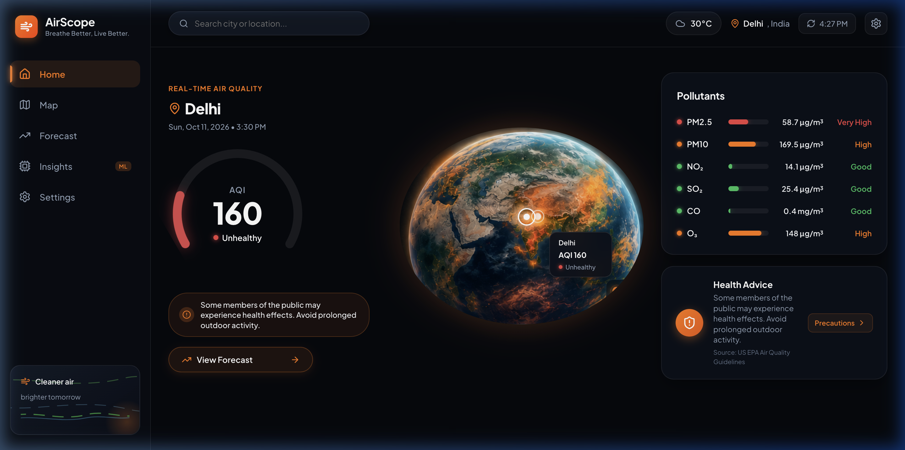
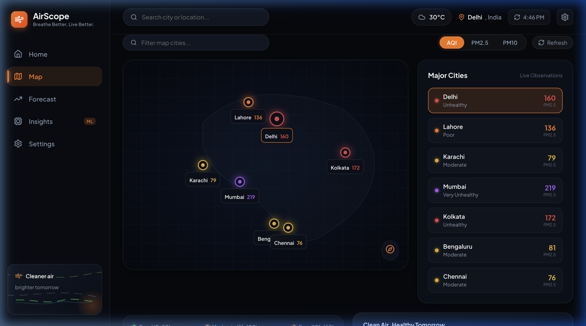
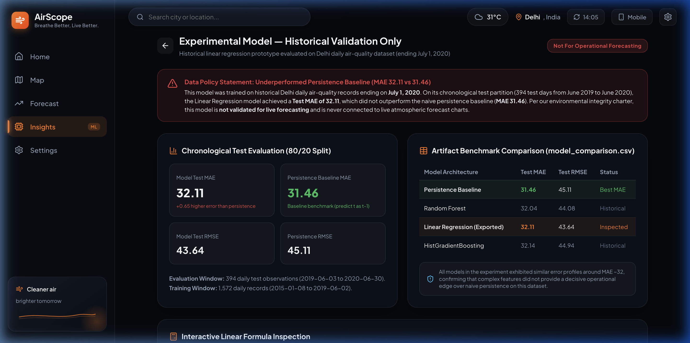
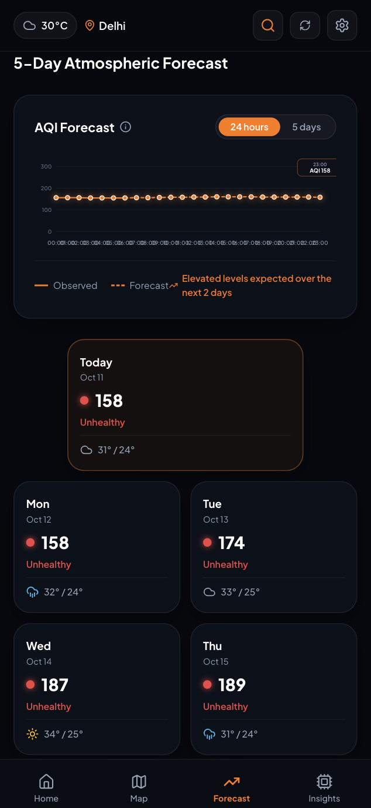
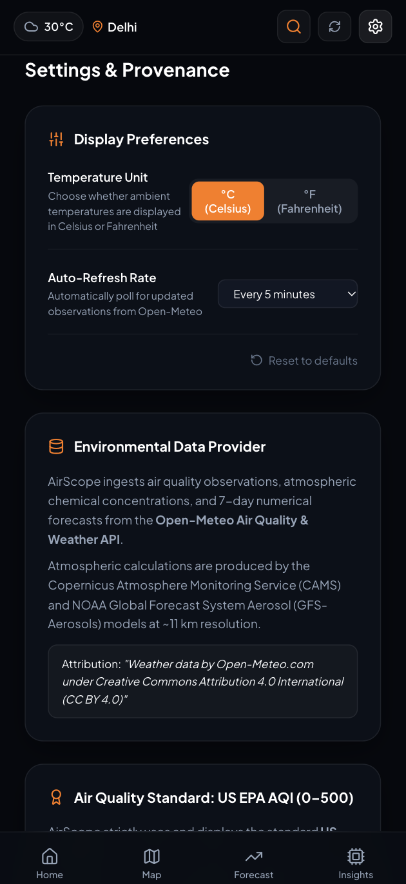
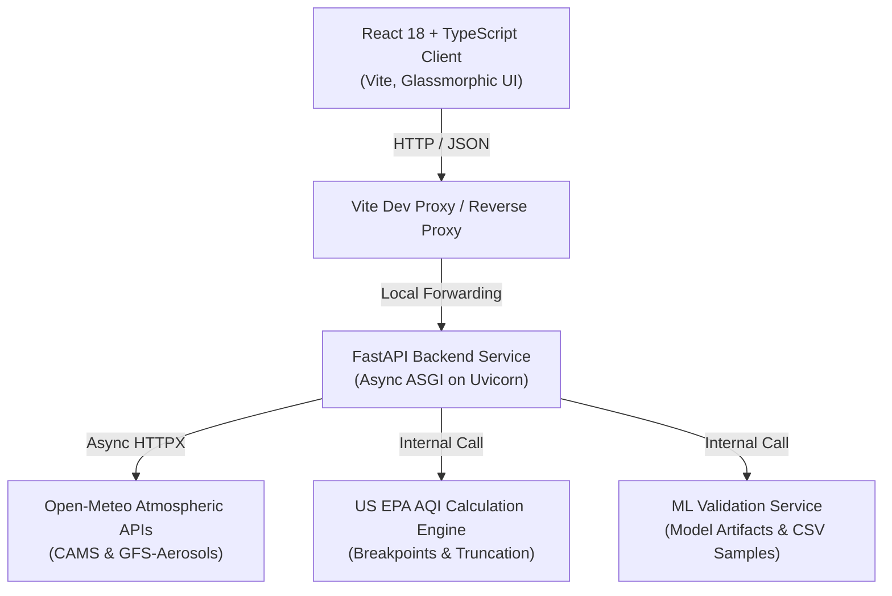

# AirScope — AQI Intelligence

<div align="center">

**Real-Time Atmospheric Intelligence • US EPA AQI Telemetry • Numerical Forecasts • Transparent ML Evaluation**

<br />

[](https://your-airscope-app.vercel.app)
[](https://your-airscope-backend.onrender.com/api/health)

<br />

> 🔗 **Live Web Application:** [https://your-airscope-app.vercel.app](https://your-airscope-app.vercel.app)  
<br />

[](https://python.org)
[](https://fastapi.tiangolo.com)
[](https://react.dev)
[](https://www.typescriptlang.org)
[](https://vitejs.dev)
[](https://creativecommons.org/licenses/by/4.0/)

</div>

---

## 📖 Executive Summary

**AirScope — AQI Intelligence** is an enterprise-grade full-stack environmental dashboard providing authentic, zero-hallucination air quality data, atmospheric forecasts, and an honest machine learning evaluation laboratory.

Unlike consumer applications that display unverified synthetic scores or opaque black-box predictions, AirScope enforces strict **US EPA Air Quality Index (0–500)** breakpoint mathematics and delivers complete provenance for every sensor reading, atmospheric transport model, and machine learning coefficient.

---

## 🌟 Core Features

### 1. Real-Time Atmospheric Dashboard
- **US EPA AQI Precision**: Piecewise linear interpolation across all six criteria pollutants ($\text{PM}_{2.5}$, $\text{PM}_{10}$, $\text{NO}_2$, $\text{SO}_2$, $\text{O}_3$, and $\text{CO}$).
- **Categorical Risk Stratification**: Color-coded categorization (Good, Moderate, Unhealthy for Sensitive Groups, Unhealthy, Very Unhealthy, Hazardous) with dynamic dial gauges.
- **Atmospheric Earth Visualizer**: Centered 3D atmospheric globe rendering reflecting real-time city pollution indices and ambient halos.
- **Actionable Health Guidance Modal**: Direct access to clinical, evidence-based EPA precautions (certified N95/KN95 respirator requirements, exertion limits, HEPA filtration protocols, and vulnerable population alerts).

### 2. Forecast & Spatial Telemetry
- **24-Hour & 5-Day Forward Outlook**: Continuous numerical pollutant projections powered by European Copernicus (**CAMS**) and NOAA GFS-Aerosol dispersion models.
- **Dedicated Forecast View**: Hourly curve scrubbing with transition markers between historical observations and future estimates.
- **Regional Cities Spatial Grid**: Concurrent multi-city telemetry across regional urban hubs (Delhi, Gurugram, Noida, Faridabad, Ghaziabad, Meerut, Panipat) queried via asynchronous non-blocking pipelines.

### 3. Transparent Machine Learning Validation
- **Segregated Historical Research**: Explicitly labeled as **"Experimental Model — Historical Validation Only"** (Not For Operational Forecasting).
- **Documented Evaluation Benchmarks**:
  - Model: Scikit-Learn Ordinary Least Squares (OLS) Linear Regression.
  - Test MAE: **32.11** | Test RMSE: **43.64**.
  - Baseline Persistence MAE: **31.46** (transparently documenting that the multi-variable model did not outperform naive persistence).
  - Dataset Cutoff: July 1, 2020.
- **Interactive Formula Inspector & "How?" Feature**:
  - Test custom inputs for current AQI, lag features ($t-1, t-2, t-3, t-7$), month, and day-of-week.
  - Interactive **"How?"** button reveals the exact regression equation with dynamically computed terms.
  - Genuine test-partition records directly loaded from `delhi_model_data.csv`.

### 4. Customizable Preferences & Provenance
- **Thermal Unit Toggle**: Instant conversion between Celsius (°C) and Fahrenheit (°F) persisted in `localStorage`.
- **Configurable Auto-Refresh**: Background telemetry polling (Manual, 1 min, 5 min, 15 min).
- **Breakpoints Reference**: Complete documentation of EPA concentration cutoffs and rounding conventions.

### 5. Responsive Mobile Experience
AirScope seamlessly adapts between widescreen desktop monitors and mobile devices:
- **Fluid Layout**: Natural single-column flow with zero horizontal scrolling and touch-friendly controls.
- **Ergonomic Bottom Bar**: 4 evenly spaced navigation tabs (`Home`, `Map`, `Forecast`, `Insights`) with instant top-bar settings access.
- **Mobile-Tailored Views**: Focused full-width regional map canvas, and vertically stacked ML inspection cards.

---

## 📸 Interface Showcase

### Desktop Experience

| Real-Time Atmospheric Dashboard |
|:---:|
|  |


| Regional Spatial Overview | ML Model Benchmark & Integrity Laboratory |
|:---:|:---:|
|  |  |


### Mobile Experience
| 5-Day Atmospheric Forecast | Settings & Environmental Provenance |
|:---:|:---:|
|  |  |

---

## 🏛️ System Architecture



---

## 💻 Tech Stack

| Domain | Technology | Key Dependencies |
|---|---|---|
| **Backend** | Python 3.9+ / FastAPI | `uvicorn`, `httpx`, `pydantic v2`, `pandas`, `joblib`, `pytest`, `anyio` |
| **Frontend** | React 18 / TypeScript 5.9 | `vite`, `lucide-react`, Vanilla CSS tokens |
| **Data Provider** | Open-Meteo Air Quality & Weather API | Global Copernicus CAMS & NOAA GFS Atmospheric Chemistry |
| **AQI Standard** | United States Environmental Protection Agency | 40 CFR Part 58, Appendix G |

---

## 📁 Repository Directory Structure

```
aqi/
├── backend/
│   ├── app/
│   │   ├── main.py                  # FastAPI route handlers & CORS configuration
│   │   ├── models.py                # Pydantic v2 domain schemas & validation
│   │   └── services/
│   │       ├── aqi_calculator.py     # Pure Python US EPA piecewise math engine
│   │       ├── open_meteo.py         # Async HTTPX client for Open-Meteo APIs
│   │       └── ml_service.py         # Joblib model loader & test partition reader
│   ├── tests/
│   │   └── test_api.py              # Automated Pytest suite (10/10 test cases)
│   ├── requirements.txt             # Python dependency manifest
│   └── .gitignore                     
├── frontend/
│   ├── src/
│   │   ├── App.tsx                  # Main state container & view router
│   │   ├── api.ts                   # Fetch client for backend API endpoints
│   │   ├── types.ts                 # Full TypeScript domain interfaces
│   │   ├── index.css                # Design system tokens, glassmorphism, animations
│   │   └── components/
│   │       ├── TopBar.tsx           # Search, weather header & mobile toggle
│   │       ├── Sidebar.tsx          # Navigation sidebar with flowing wind animation
│   │       ├── AQIGauge.tsx         # Circular AQI gauge & forecast navigation button
│   │       ├── EarthHero.tsx        # Glowing atmospheric Earth visualizer
│   │       ├── PollutantsCard.tsx   # Criteria pollutant bars & levels
│   │       ├── HealthAdviceCard.tsx # Quick health card triggering precautions modal
│   │       ├── HealthModal.tsx      # Comprehensive clinical EPA health precautions
│   │       ├── ForecastChart.tsx    # Interactive 24h & 5-day scrubbable SVG chart
│   │       ├── FiveDayCards.tsx     # 5-day weather & AQI forecast cards
│   │       ├── MapView.tsx          # Concurrent regional cities spatial overview
│   │       ├── AIExperimentalView.tsx # ML validation laboratory & "How?" inspector
│   │       ├── SettingsView.tsx     # Display units, auto-refresh, and EPA breakpoints
│   │       └── MobileView.tsx       # Dedicated responsive smartphone preview
│   ├── vite.config.ts               # Vite configuration with /api backend proxy
│   └── package.json                 # Node dependencies and build scripts
├── docs/screenshots/                # Look of Website
├── aqi_project_files/               # Authentic Delhi Colab model artifacts
│   ├── delhi_aqi_model.joblib       # Serialized Scikit-Learn linear regression model
│   ├── delhi_model_data.csv         # Full 1,966-day historical dataset (2015-2020)
│   ├── model_config.json            # Features, coefficients, and persistence baseline
│   └── model_comparison.csv         # Benchmark comparison table across architectures
└── README.md                        # Project documentation
```

---

## 🚀 Installation & Running Locally

### Prerequisites
- **Python 3.9+** (`python3 --version`)
- **Node.js 18+** & **npm** (`node -v`, `npm -v`)

---

### Step 1: Start the Backend (FastAPI)

```bash
# 1. Navigate to backend directory
cd backend

# 2. Create and activate virtual environment
python3 -m venv .venv
source .venv/bin/activate       # macOS / Linux
# .venv\Scripts\activate       # Windows PowerShell

# 3. Install Python dependencies
pip install -r requirements.txt

# 4. Start the FastAPI ASGI server
uvicorn app.main:app --host 127.0.0.1 --port 8000 --reload
```

- **API Base URL**: `http://127.0.0.1:8000`
- **Health Check**: `http://127.0.0.1:8000/api/health`
- **Interactive Swagger Docs**: `http://127.0.0.1:8000/docs`

---

### Step 2: Start the Frontend (React + Vite)

Open a **separate terminal window**:

```bash
# 1. Navigate to frontend directory
cd frontend

# 2. Install Node dependencies
npm install

# 3. Start the Vite development server
npm run dev
```


---

## 🧪 Testing & Quality Assurance

### Run Backend Tests (Pytest)
```bash
cd backend
source .venv/bin/activate
pytest tests/test_api.py -v
```
**Test Coverage Includes:**
- Exact US EPA mathematical breakpoint formula calculation.
- Criteria pollutant decimal truncation rules.
- Geocoding and spatial coordinate input boundary validation.
- Live Open-Meteo ingestion and fallback error-handling.
- Concurrent multi-city regional aggregation.
- Model artifact loading and metrics verification.

### Run Frontend Production Build & TypeScript Verification
```bash
cd frontend
npm run build
```
---

## 📡 API Reference

### `GET /api/health`
Checks server and upstream data provider connectivity.
```json
{
  "status": "healthy",
  "provider": "Open-Meteo (CAMS / ECMWF / NOAA)",
  "standard": "US EPA AQI (0-500)",
  "timestamp": "2026-10-11T10:30:00Z"
}
```

### `GET /api/search?q={query}`
Performs global geocoding queries returning matching locations worldwide.

### `GET /api/air-quality?lat={lat}&lon={lon}`
Returns real-time air quality observations, criteria pollutant concentrations, individual EPA sub-indices, dominant pollutant, and ambient weather.

### `GET /api/forecast?lat={lat}&lon={lon}&days=7`
Returns 7-day hourly pollutant projections and 5-day daily forecast summaries.

### `GET /api/regional-cities`
Fetches real-time AQI and weather for 7 regional cities concurrently using non-blocking asynchronous requests.

### `GET /api/ml/evaluation`
Serves authentic historical evaluation benchmarks, exact feature coefficients, and test partition sample records for the Delhi model.

---


## 🔬 Mathematical Standards & Policies

### 1. US EPA AQI Equation
Each pollutant sub-index $I_p$ is calculated using the standard EPA piecewise linear function:

$$I_p = \frac{I_{hi} - I_{lo}}{BP_{hi} - BP_{lo}} (C_p - BP_{lo}) + I_{lo}$$

Where:
- $C_p$ is the truncated pollutant concentration.
- $BP_{hi}$ and $BP_{lo}$ are the concentration breakpoint boundaries.
- $I_{hi}$ and $I_{lo}$ are the corresponding AQI index boundaries.
- Overall AQI is defined by the governing dominant pollutant: $I = \max(I_{\text{PM2.5}}, I_{\text{PM10}}, I_{\text{NO2}}, I_{\text{SO2}}, I_{\text{O3}}, I_{\text{CO}})$.

### 2. Historical ML Model Specification
The Delhi validation model uses the following Ordinary Least Squares (OLS) specification:

$$\widehat{\text{AQI}}_{t+1} = 16.0149 + 0.8760 \cdot \text{AQI}_t - 0.1879 \cdot \text{AQI}_{t-1} + 0.1237 \cdot \text{AQI}_{t-2} + 0.0431 \cdot \text{AQI}_{t-3} + 0.0756 \cdot \text{AQI}_{t-7} + 0.7858 \cdot \text{Month} - 0.5916 \cdot \text{DayOfWeek}$$

- **Training Window**: 2015-01-01 to 2019-05-18 (80%).
- **Test Window**: 2019-05-19 to 2020-07-01 (20%).
- **Evaluation**: Test MAE = 32.11 vs. Naive Persistence Baseline MAE = 31.46.

---

## 📜 Attribution & Licensing

- **Atmospheric Data**: Provided by [Open-Meteo](https://open-meteo.com) under the [Creative Commons Attribution 4.0 International (CC BY 4.0)](https://creativecommons.org/licenses/by/4.0/) license.
- **Atmospheric Models**: Generated by the Copernicus Atmosphere Monitoring Service (**ECMWF CAMS**) and NOAA Global Forecast System (**GFS-Aerosols**).
- **AQI Calculation Guidelines**: Derived from the United States Environmental Protection Agency (**US EPA**) Office of Air Quality Planning and Standards.
